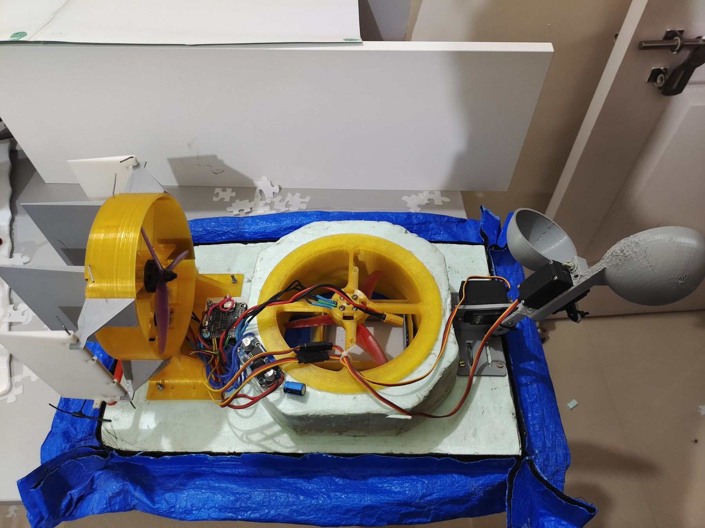
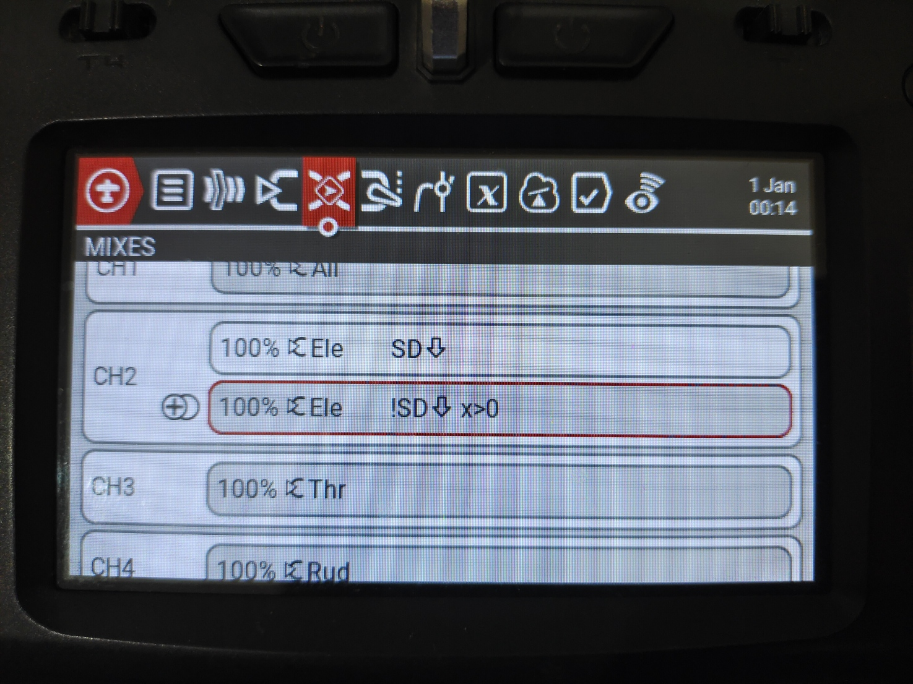
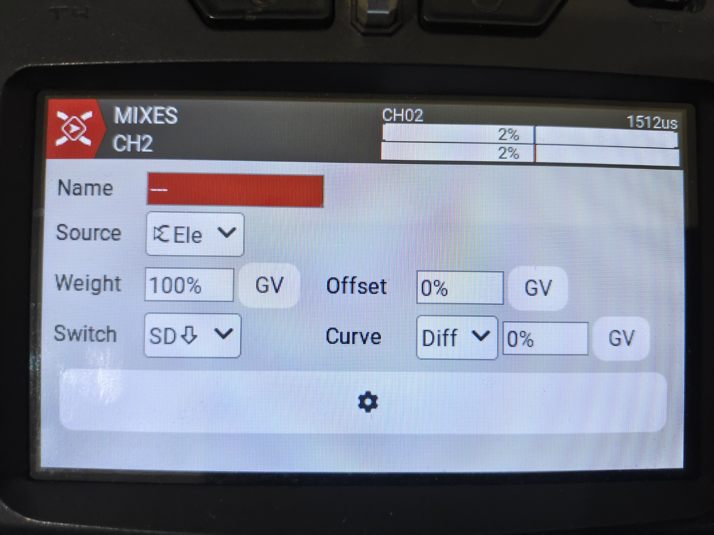
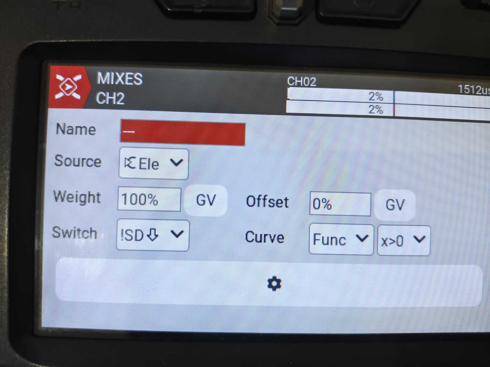
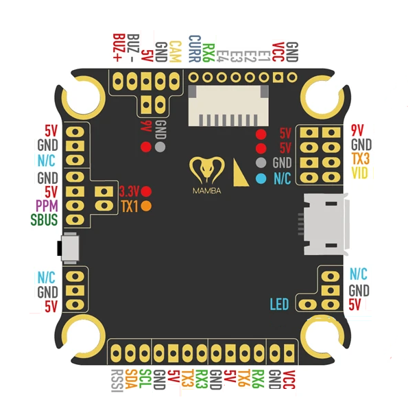
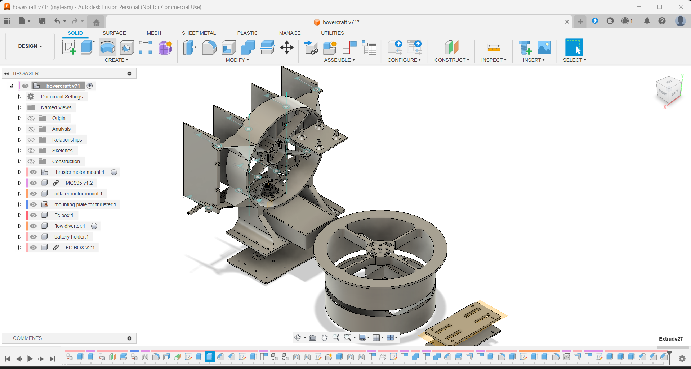

# DIY Hovercraft firmware for stm32F405 board

Hovercraft firmware for mamba f405 mk2 based stm32 based flight controller

## Channel Assignments(the project uses CRSF as RX protocol)

- CH1 -> Alerion
- CH2 -> Elevator
- CH3 -> Throttle
- CH4 -> Rudder
- CH5 -> ARM
- CH6 -> Pre-arm (if held down after arming will reverse throttle motor)
- CH7 -> NONE
- CH8 -> NONE
- CH9 -> Beeper
- CH10 -> Servo X (connected to SDA pin)
- CH11 -> Servo Y (connected to SDA pin)

> NOTE : for the above configuration to work you have to add a logic to your EDGE TX transmitter so as to disable 3D mode as by default your ESC needs to have 3d mode enabled and for 0 throttle elevator stick should be centered.

## comments

Beep working for cmd setting why telem needs to be set 1 i dont know
reverse and normal direction working
3d mode working when used with esc configurator.com (have to flash betaflight for that)
basic hovercraft working
PRE ARM Added
Basic Failsafe working on RX lost
CRC algo not touching as betaflight also uses same only
proper telemetry working

## changes

Telemetry only sent just after when packet received

## next steps

- implement filter
- receving algo , baud rate as f1000
- implement msp for esc configurator.com

## imp links

https://github.dev/betaflight/betaflight/betaflight/src/main/drivers/dshot_command.h
https://github.dev/betaflight/betaflight/betaflight/src/main/drivers/dshot.h
https://github.com/Carbon225/esp32-dshot/blob/master/DShotRMT.cpp
https://github.com/crsf-wg/crsf/wiki/Physical-Layer -> default baud rate is 416666   

## 3D files   
You can find the fusion 360 f3d file in the 3d files folder 
The full design has been made by me and is copyrighted and is NOT to be used for commercial purposes 
